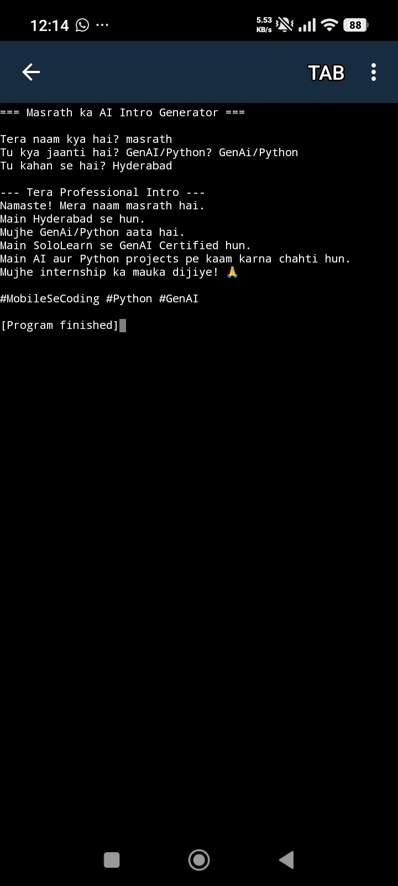

# 👋 Hi, I'm Masrath from Hyderabad, India

### GenAI Certified | Python Learner | Building AI Skills on Mobile 📱

I built my first Python project entirely on my Android phone using Pydroid 3. No laptop, no excuses - just pure determination! 💪

---

## 🎯 About This Project
**Masrath ka AI Intro Generator** - This is my Day 1 Python script that takes user input and generates a professional intro.

**What it does:**
- Asks for name, skills, and city using `input()`
- Generates a formatted professional intro
- Shows I understand variables, print statements, and user interaction
- Proves you can start coding from anywhere with just a phone

## 📱 Tech Stack
- **Language:** Python 3
- **Editor:** Pydroid 3 Mobile IDE
- **Version Control:** GitHub Mobile
- **Built On:** Android Phone

## 📸 Output Screenshot

## 💻 Code File
Check `Masrathintro. Py` to see the full code

## 🚀 What's Next
1. Learn Python basics: loops, functions, lists, dictionaries
2. Build mini projects: calculator, number guessing game, to-do list
3. Start Data Structures & Algorithms
4. **Goal:** Land an AI/ML Internship in 2026

## 📫 Connect With Me
- **Email:** smasrath236@gmail.com
- **Location:** Hyderabad, Telangana, India
- **Status:** Open to Internships & Learning Opportunities

---
**#MobileSeCoding #Python #GenAI #WomenInTech #Hyderabad #100DaysOfCode #BuildInPublic**
